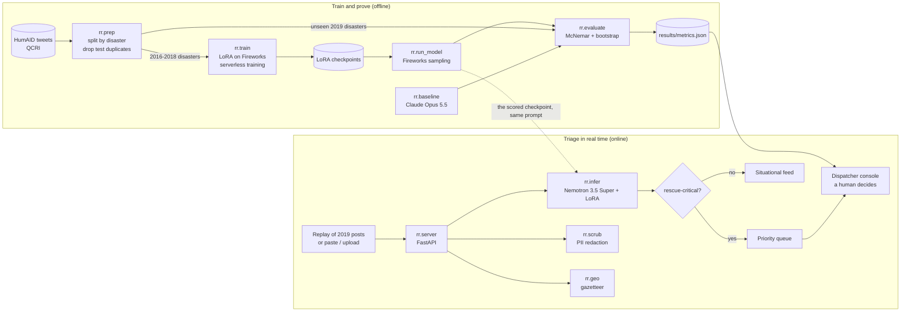

<!-- Generated from README.template.md by scripts/render_docs.py. Edit the template, then re-run the script. -->
<div align="center">


### Find the people asking for rescue in the flood of disaster posts, in real time.

[](https://github.com/vnmoorthy/rescue-radar/actions/workflows/ci.yml)
[](LICENSE)
[](https://www.python.org/)
[](https://fireworks.ai/)
[](https://www.nvidia.com/en-us/ai-data-science/foundation-models/nemotron/)
[](https://microsoft.github.io/presidio/)
[](https://huggingface.co/datasets/QCRI/HumAID-events)
[](#hackathon-disclosure)
[](#results)

**[Live demo](https://vnmoorthy.github.io/rescue-radar/)** &nbsp;·&nbsp;
**[Slides](https://vnmoorthy.github.io/rescue-radar/deck/)** &nbsp;·&nbsp;
[Results](#results) &nbsp;·&nbsp; [How it works](#how-it-works) &nbsp;·&nbsp; [Quickstart](#quickstart) &nbsp;·&nbsp;
[Evaluation design](guide/EVALUATION.md)

</div>

---

**Rescue Radar reads every public post during a disaster, sorts it into the 10 HumAID humanitarian categories, and pushes the rescue-critical ones (people asking for help, people injured or killed, people missing or trapped) to the top of a dispatcher's queue.** The model is NVIDIA Nemotron 3.5 Super, fine-tuned with LoRA on Fireworks serverless training and served through Fireworks serverless sampling, and it is tested on 4 disasters from 2019 that it never saw during training.

> [!IMPORTANT]
> Paired on the **2,592** held-out posts from 4 unseen disasters that both systems answered, Rescue Radar catches **85.3%** of rescue-critical posts against **68.8%** for Claude Opus 5.5, 20-shot (**+16.5 pts**, 95% CI +11.2 to +21.9 pts, so the gain is not luck of the draw). Macro-F1 is 69.2% against 63.7% (+5.5 pts, 95% CI +2.6 to +8.5 pts). Rescue-critical precision is lower (60.2% vs 78.1%, each on the posts it answered).
>
> It costs **$171 per million posts** against $8,738 (51.1x cheaper at Fireworks' current rate, which includes a limited-time 50% discount; 25.5x at the undiscounted rate). It is slower per post: median latency 3.37 s against 1.31 s. Statistics, intervals and caveats are in [Results](#results).

## Contents

[Why this matters](#why-this-matters) · [Results](#results) · [How it works](#how-it-works) · [Evaluation design](#evaluation-design-held-out-disasters) · [Quickstart](#quickstart) · [Reproduce the benchmark](#reproduce-the-benchmark) · [Repository layout](#repository-layout) · [Sponsor stack](#sponsor-stack) · [Responsible AI and limitations](#responsible-ai-and-limitations) · [Roadmap](#roadmap) · [Contributing](#contributing) · [Citation](#citation) · [Team](#team)

## Why this matters

When a hurricane or an earthquake hits, emergency lines saturate, and people turn to public social media to ask for help: an address, a trapped family, a missing child. Those posts are scattered among thousands of prayers, news links, donation drives and jokes. Responders have had to read them by hand.

The signal is rare. In the held-out evaluation set, only **8.5%** of posts (254 of 3,001) are rescue-critical. A dispatcher cannot read the other 91.5% fast enough. Rescue Radar reads all of them and puts the few that matter first, with personal data redacted, a location when the post names a known place, and a human making every decision.

Why a fine-tuned open model instead of a frontier API? What [Results](#results) measures against Claude Opus 5.5, 20-shot: significantly higher rescue-critical recall (+16.5 pts, at lower precision), macro-F1 +5.5 pts (95% CI +2.6 to +8.5 pts), and about 51.1x lower serving cost (25.5x at the undiscounted rate). It is slower per post on shared serverless capacity (3.37 s median against 1.31 s). The base model is open, so the small LoRA adapter could be exported for an agency to host itself instead of sending every post to a third-party API; that export is not built yet.

## Results

Evaluated on **3,001** posts sampled from 4 disasters of 2019, none of which were in our fine-tuning data ([evaluation design](#evaluation-design-held-out-disasters)). Every system gets the same instructions and the same 10 category definitions; the 20-shot baselines also get 20 examples. **Not every system answered every post:** the Anthropic account hit its spending cap mid-run, so Claude Opus 5.5, 20-shot was scored on the 2,592 posts it answered (86%), Claude Opus 5.5, zero-shot was scored on the 1,920 posts it answered (64%). Each row's score is on its own posts; the comparisons below are paired on the posts both systems answered.

| System | Posts scored | Macro-F1 | Accuracy | Rescue-critical recall | p50 latency | Cost per 1M posts |
| --- | --- | --- | --- | --- | --- | --- |
| **Rescue Radar, main run (13,839 examples)** | 3,001 | **69.2%**<br><sub>64.8% to 72.2%</sub> | 72.4%<br><sub>70.9% to 74.0%</sub> | 84.7%<br><sub>80.2% to 88.9%</sub> | 3.37 s | $171 |
| Claude Opus 5.5, 20-shot | 2,592 | 63.7%<br><sub>59.1% to 67.3%</sub> | 70.9%<br><sub>69.1% to 72.5%</sub> | 68.8%<br><sub>62.7% to 75.0%</sub> | 1.31 s | $8,738 |
| Claude Opus 5.5, zero-shot | 1,920 | 62.2%<br><sub>57.6% to 67.0%</sub> | 70.2%<br><sub>68.2% to 72.2%</sub> | 71.9%<br><sub>64.7% to 78.9%</sub> | 1.87 s | $3,412 |
| GPT-6.1 Terra, 20-shot | 3,001 | 60.6%<br><sub>56.6% to 63.9%</sub> | 67.8%<br><sub>66.2% to 69.5%</sub> | 70.9%<br><sub>65.4% to 76.2%</sub> | 1.28 s | $1,418 |
| GPT-6.1 Terra, zero-shot | 3,001 | 60.6%<br><sub>56.6% to 63.7%</sub> | 66.7%<br><sub>65.0% to 68.4%</sub> | 71.7%<br><sub>66.3% to 77.0%</sub> | 1.30 s | $499 |
| Nemotron 3.5 Super, no fine-tuning | 3,001 | 57.6%<br><sub>54.2% to 60.5%</sub> | 66.0%<br><sub>64.3% to 67.6%</sub> | 65.3%<br><sub>59.7% to 71.2%</sub> | 734 ms | $171 |
| Rescue Radar, small-data run (3,939 examples) | 3,001 | 65.0%<br><sub>61.8% to 67.8%</sub> | 70.9%<br><sub>69.3% to 72.5%</sub> | 77.2%<br><sub>72.2% to 82.2%</sub> | 4.21 s | $171 |

<sub>Small numbers are 95% bootstrap intervals (5,000 paired resamples of tweets, stratified by disaster). Rescue-critical recall: the share of posts whose true label is one of `requests_or_urgent_needs`, `injured_or_dead_people`, `missing_or_found_people` that the system also labels as one of those three. Latency is wall-clock time per post as measured during the benchmark run (Rescue Radar and base Nemotron through Fireworks serverless sampling with 32 parallel requests on shared capacity, Claude through the Anthropic API with 24), so it reflects load as well as the model. Cost is measured tokens times published per-token prices:
<br>Rescue Radar, main run (13,839 examples): measured tokens x Fireworks published sampling rate for Nemotron 3.5 Super ($0.57 prefill / $1.44 sample per 1M tokens, includes a limited-time 50% discount; about 2x without it).
<br>Claude Opus 5.5, 20-shot: measured tokens x Anthropic list price ($4 in / $20 out per 1M tokens, thinking tokens included).
<br>Claude Opus 5.5, zero-shot: measured tokens x Anthropic list price ($4 in / $20 out per 1M tokens, thinking tokens included).
<br>GPT-6.1 Terra, 20-shot: measured tokens x OpenAI list price ($1 in / $5 out per 1M tokens, reasoning tokens included).
<br>GPT-6.1 Terra, zero-shot: measured tokens x OpenAI list price ($1 in / $5 out per 1M tokens, reasoning tokens included).
<br>Nemotron 3.5 Super, no fine-tuning: measured tokens x Fireworks published sampling rate for Nemotron 3.5 Super ($0.57 prefill / $1.44 sample per 1M tokens, includes a limited-time 50% discount; about 2x without it).
<br>Rescue Radar, small-data run (3,939 examples): measured tokens x Fireworks published sampling rate for Nemotron 3.5 Super ($0.57 prefill / $1.44 sample per 1M tokens, includes a limited-time 50% discount; about 2x without it).
</sub>

### Is the difference real?

Both systems answered the same 2,592 of the 3,001 posts, so we compare them post by post on those: Rescue Radar 69.2% macro-F1 and 85.3% rescue-critical recall, Claude Opus 5.5, 20-shot 63.7% and 68.8%.

- **Paired exact test (McNemar).** Rescue Radar was right where Claude Opus 5.5, 20-shot was wrong on **291** posts, and the reverse happened on **233** posts. If both systems were equally accurate, a split at least this uneven would happen by chance with p = 0.013.
- **Paired bootstrap, stratified by disaster.** Resampling tweets within each disaster 5,000 times, the 95% interval for Rescue Radar minus Claude Opus 5.5, 20-shot is +2.6 to +8.5 pts for macro-F1, +0.5 to +4.0 pts for accuracy and +11.2 to +21.9 pts for rescue-critical recall. Rescue Radar has the higher macro-F1 in 4,997 of 5,000 resamples.
- **In plain words:** the macro-F1 advantage is not luck of the draw. The whole 95% interval is above zero.

<details>
<summary><b>Every pairwise comparison</b></summary>

| Rescue Radar vs | Macro-F1 difference (95% CI) | Accuracy difference (95% CI) | Rescue-critical recall difference (95% CI) | Ours right, theirs wrong / reverse | McNemar |
| --- | --- | --- | --- | --- | --- |
| Rescue Radar, small-data run (3,939 examples) | +4.2 pts (+2.0 to +6.5 pts) | +1.5 pts (+0.3 to +2.7 pts) | +7.5 pts (+3.7 to +11.4 pts) | 197 / 151 | p = 0.016 |
| Nemotron 3.5 Super, no fine-tuning | +11.7 pts (+8.9 to +14.4 pts) | +6.5 pts (+4.8 to +8.1 pts) | +19.3 pts (+14.2 to +24.4 pts) | 429 / 235 | p < 0.001 |
| Claude Opus 5.5, 20-shot | +5.5 pts (+2.6 to +8.5 pts) | +2.2 pts (+0.5 to +4.0 pts) | +16.5 pts (+11.2 to +21.9 pts) | 291 / 233 | p = 0.013 |
| Claude Opus 5.5, zero-shot | +8.1 pts (+3.1 to +13.6 pts) | +3.3 pts (+1.1 to +5.4 pts) | +17.6 pts (+11.2 to +24.3 pts) | 251 / 188 | p = 0.003 |
| GPT-6.1 Terra, 20-shot | +8.6 pts (+5.5 to +12.2 pts) | +4.6 pts (+2.9 to +6.3 pts) | +13.8 pts (+9.1 to +18.7 pts) | 412 / 273 | p < 0.001 |
| GPT-6.1 Terra, zero-shot | +8.6 pts (+6.0 to +11.4 pts) | +5.7 pts (+4.0 to +7.5 pts) | +13.0 pts (+8.7 to +17.6 pts) | 431 / 259 | p < 0.001 |

</details>

<details>
<summary><b>Per disaster</b>: does it hold up on each unseen event?</summary>

| Disaster (2019) | Posts | Rescue Radar macro-F1 | Claude Opus 5.5, 20-shot macro-F1 | Rescue Radar critical recall | Claude Opus 5.5, 20-shot critical recall |
| --- | --- | --- | --- | --- | --- |
| Hurricane Dorian (2019) | 1,485 | 60.4% | 53.5% | 59.6% | 21.7% |
| Cyclone Idai (2019) | 767 | 65.6% | 57.0% | 90.5% | 79.0% |
| Pakistan Earthquake (2019) | 382 | 54.0% | 53.6% | 93.8% | 89.0% |
| Midwestern US Floods (2019) | 367 | 48.6% | 43.7% | 60.0% | 0.0% |

</details>

<details>
<summary><b>Rescue-critical categories</b>: precision, recall and F1 per class</summary>

| Category | Posts in eval set | Rescue Radar P / R / F1 | Claude Opus 5.5, 20-shot P / R / F1 |
| --- | --- | --- | --- |
| Requests or urgent needs | 78 | 28.8% / 60.3% / 39.0% | 35.9% / 20.9% / 26.4% |
| Injured or dead people | 172 | 88.0% / 94.2% / 91.0% | 92.3% / 89.2% / 90.7% |
| Missing or found people | 4 | 40.0% / 100.0% / 57.1% | 30.0% / 100.0% / 46.2% |

Small classes have wide intervals: read per-class numbers for categories with few posts as indicative only.

</details>

<sub>Results generated 2026-11-02T15:04:54 by `python -m rr.evaluate`. Full numbers, including confusion matrices: [`results/metrics.json`](results/metrics.json).</sub>

## How it works

1. **Ingest.** Posts arrive one by one. The demo replays the real 2019 disaster tweets in their original order (a tweet ID is a Twitter snowflake, so its post time is `(id >> 22) + 1288834974657` ms), or classifies text you paste or upload. Live stream ingestion is not built yet.
2. **Classify.** One instruction prompt with the 10 category definitions, one label out. The LoRA-tuned Nemotron runs on Fireworks serverless sampling at temperature 0; its reasoning block is closed in the prompt so it answers with the label alone.
3. **Prioritize.** Rescue-critical labels (`requests_or_urgent_needs`, `injured_or_dead_people`, `missing_or_found_people`) go to the priority queue. Everything else stays in the situational-awareness feed.
4. **Protect.** Before a person reads a post, `rr/scrub.py` replaces phone numbers, emails, handles, URLs and street addresses with placeholders, and people's names too when Microsoft Presidio is installed (a regex-only engine runs otherwise). This is best effort, and it applies to what the dispatcher sees: the raw post is what goes to the model providers.
5. **Locate.** `rr/geo.py` maps place names in the post to coordinates with a gazetteer of the affected areas. It never guesses a location for a post that names no known place.
6. **Decide.** A dispatcher works the queue: dispatch, resolve or dismiss, with notes, and exports it as CSV. The model ranks; a human decides.

The live console and the benchmark share the same code path, `rr.infer.SamplerClassifier`, with the same prompt from `rr/labels.py`. By default the server serves exactly the checkpoint the benchmark scored for the headline system (recorded in `data/preds/<system>.meta.json`), and the console's header badge says "scored". `RR_LIVE_MODEL=latest` serves the newest training checkpoint instead, and the badge then says it is not scored.

<p align="center">
  
</p>



More detail: [guide/ARCHITECTURE.md](guide/ARCHITECTURE.md) and the HTTP contract in [guide/API.md](guide/API.md).

## Evaluation design: held-out disasters

A model that has seen a disaster's tweets during training can look much better than it will be on the next disaster. So the split is by **event**, not by tweet:

| | Disasters | Years | Posts |
| --- | --- | --- | --- |
| Train | 15 HumAID events | 2016 to 2018 | 13,839 in the training file, 13,839 used by the headline model |
| Test | 4 unseen events: Cyclone Idai (2019), Hurricane Dorian (2019), Midwestern US Floods (2019), Pakistan Earthquake (2019) | 2019 | 15,384 in total; a seeded, event-stratified sample of 3,001 is the shared eval set |

- **No leakage by copy.** Training tweets whose normalized text also appears in the test events (retweets, copies) are removed: 1 of 61,100 training-event tweets.
- **Prompt parity.** Every system gets the same system prompt and category definitions (`rr/labels.py`). The 20-shot frontier baseline adds two fixed training examples per category.
- **Baselines.** Claude Opus 5.5, 20-shot as the strongest frontier reference (zero-shot and 20-shot), and the same Nemotron base model without fine-tuning, served through the same Fireworks path, so the gain from LoRA is isolated. GPT-6.1 Terra (zero-shot and 20-shot, through the OpenAI API) was added after pre-registration.
- **Statistics.** Exact McNemar test on per-post correctness, and a paired bootstrap resampled within each disaster for every interval.
- **Measured, not estimated.** Latency is measured per call; cost is measured token counts times published prices. The choice of the headline system and metrics was fixed before test-set scoring ([`guide/PREREGISTRATION.md`](guide/PREREGISTRATION.md)).
The full method is in [guide/EVALUATION.md](guide/EVALUATION.md).

## Quickstart

Requirements: Python 3.12, a [Fireworks AI](https://fireworks.ai/) API key (training and serving), an [Anthropic](https://console.anthropic.com/) API key (frontier baseline and the Head-to-Head view), optionally an [OpenAI](https://platform.openai.com/) API key (the GPT-6.1 Terra baseline, and the Head-to-Head fallback when the Anthropic account is out of quota) and a [Hugging Face](https://huggingface.co/settings/tokens) token (the Nemotron tokenizer).

```bash
git clone https://github.com/vnmoorthy/rescue-radar.git
cd rescue-radar
python3 -m venv .venv && source .venv/bin/activate
pip install -r requirements.txt
```

Create a `.env` file in the repo root (it is git-ignored; never commit it):

```bash
FIREWORKS_API_KEY=...
ANTHROPIC_API_KEY=...
OPENAI_API_KEY=...      # optional: GPT-6.1 Terra baseline and Head-to-Head fallback
HF_TOKEN=...
```

Then build the data, train, evaluate and open the console:

```bash
python -m rr.prep        # download HumAID, build the held-out-disaster split
python -m rr.train       # LoRA fine-tune on Fireworks serverless training
python -m rr.evaluate    # score every system, write results/metrics.json
python -m rr.server      # dispatch console and API
```

Open **http://localhost:8787**. No keys at hand? The [live demo](https://vnmoorthy.github.io/rescue-radar/) replays the recorded predictions with no backend at all.

## Reproduce the benchmark

```bash
python -m rr.prep                                   # data/eval.jsonl, data/test_full.jsonl, data/train_sft.jsonl
RR_TAG=_full RR_PER_CLASS=1500 python -m rr.train   # headline run: every example in data/train_sft.jsonl
python -m rr.train                                  # small-data ablation run (default 400 per class)
python -m rr.run_model rescue_radar                 # fine-tuned model, final checkpoint of the headline run
python -m rr.run_model rescue_radar_quick           # ablation
python -m rr.run_model base_zero                    # Nemotron 3.5 Super without fine-tuning
python -m rr.baseline opus_zero                     # Claude Opus 5.5, zero-shot
python -m rr.baseline opus_few                      # Claude Opus 5.5, 20-shot
python -m rr.evaluate                               # results/metrics.json
python scripts/render_docs.py                       # re-render README.md and the guides with the new numbers
```

Every prediction script is resumable: rows already in `data/preds/<system>.jsonl` are skipped. Training writes a sampler checkpoint every 25 steps, so the newest one can be evaluated even if a run is cut short. The headline training run logged 294 of 432 steps so far (still training) in 85 minutes of training time on Fireworks serverless.
## Repository layout

```text
rescue-radar/
├── rr/                      Python package
│   ├── labels.py            the 10 HumAID categories, RESCUE_CRITICAL, the single prompt
│   ├── prep.py              held-out-disaster split and de-duplication
│   ├── train.py             LoRA fine-tune on Fireworks serverless training
│   ├── infer.py             the live model: Fireworks serverless sampling
│   ├── run_model.py         scores the open models on the eval set
│   ├── baseline.py          scores Claude Opus 5.5 (zero-shot, 20-shot)
│   ├── frontier.py          live Claude call for the Head-to-Head view
│   ├── evaluate.py          metrics, McNemar, stratified bootstrap -> results/metrics.json
│   ├── promote.py           promote a checkpoint to a permanent Fireworks model
│   ├── server.py            FastAPI app: /api/* and the console
│   ├── scrub.py             PII redaction before a human reads a post
│   ├── geo.py               gazetteer: place names -> coordinates
│   └── store.py             dispatcher queue (SQLite in state/)
├── web/                     dispatch console, no build step
├── docs/                    GitHub Pages: static console + slide deck
├── scripts/                 render_docs.py, export_static.py, make_dev_fixtures.py, check_secrets.py
├── data/                    eval set, predictions, training logs (generated)
├── results/metrics.json     benchmark results
├── guide/                   API contract, architecture, evaluation, deployment, demo runbook
├── assets/                  hero and architecture art
└── tests/                   pytest suite (runs without API keys)
```

## Sponsor stack

| Sponsor | What we use | Where in the code |
| --- | --- | --- |
| **Fireworks AI** | Serverless LoRA training (`create_lora_training_client`, cross-entropy on the label tokens, Adam steps, `save_weights_for_sampler` checkpoints) and serverless sampling of the trained adapter (`create_sampling_client`). The benchmark and the live console use the same sampling path. | `rr/train.py`, `rr/infer.py`, `rr/run_model.py`, `rr/promote.py` |
| **NVIDIA** | Nemotron 3.5 Super (`nvidia-nemotron-3p5-super-vl-120b-a12b-bf16` on Fireworks) is the base model we fine-tune; its tokenizer comes from Hugging Face. | `rr/train.py`, `rr/infer.py` |
| **Microsoft** | [Microsoft Presidio](https://microsoft.github.io/presidio/) (presidio-analyzer with spaCy, presidio-anonymizer) redacts personal data before a dispatcher reads a post, merged with regexes for handles, URLs and addresses; when Presidio is not installed, the regex engine runs alone. Deployment to Microsoft Foundry is a documented next step, not yet implemented: see [guide/DEPLOYMENT.md](guide/DEPLOYMENT.md). | `rr/scrub.py` |

Also used: **Anthropic** Claude Opus 5.5 as the frontier baseline (`rr/baseline.py`, `rr/frontier.py`), and **QCRI**'s HumAID dataset.

## Responsible AI and limitations

- **A human decides.** Rescue Radar ranks posts; it never dispatches anyone. Every queue item needs a dispatcher's action, and the model can be wrong, especially on a kind of disaster or a way of writing it has not seen.
- **Old data, one platform.** HumAID is English-language Twitter data from 2016 to 2019. Language, platforms and the way people ask for help have changed since; performance on today's platforms is untested.
- **The most important classes are the smallest.** In the eval set, `requests_or_urgent_needs` has 78 posts and `missing_or_found_people` has 4. Per-class numbers for them have wide intervals, and a high overall score does not guarantee every request is caught.
- **Uneven coverage.** Hurricane Dorian (2019) alone is 49.5% of the eval set; results are weighted toward that disaster (per-disaster numbers are reported separately).
- **Most posts have no location.** The gazetteer only resolves places it knows by name; posts without a named place have no coordinates and must be located by a person.
- **Redaction is best effort.** PII redaction reduces exposure; it does not guarantee that no personal data reaches a reader (the small spaCy model misses some names). It applies to what the dispatcher sees: raw posts are sent to the model providers (Fireworks, and Anthropic or OpenAI for the frontier comparison).
- **Not every baseline answered every post.** Claude Opus 5.5, 20-shot answered 2,592 posts (86%) before the Anthropic spending cap. Claude Opus 5.5, zero-shot answered 1,920 posts (64%) before the Anthropic spending cap. Comparisons are paired on the posts both systems answered.
- **Unseen by our fine-tune, not necessarily by every model.** The 2019 test disasters are absent from our fine-tuning data, but they are public tweets (and HumAID has been public since 2021), so we cannot rule out that any model saw them in pretraining.
- **Non-commercial data.** HumAID is licensed CC BY-NC-SA 4.0. The code in this repo is MIT, but models trained on HumAID and derived data inherit the non-commercial, share-alike terms.

## Roadmap

- [ ] Dedicated Fireworks deployment of the promoted model for steady latency at disaster-time volume
- [ ] Microsoft Foundry deployment path for agencies that run on Azure
- [ ] Learn from dispatcher actions: dispatched and dismissed items become new training labels
- [ ] Cluster near-duplicate requests so one address is not dispatched five times
- [ ] Location extraction beyond the gazetteer (named-entity recognition plus a geocoder) with uncertainty shown on the map
- [ ] Multilingual evaluation and newer events from other crisis datasets
- [ ] Calibrated confidence and an "unsure, send to a human" path, then confidence-aware escalation of uncertain posts to a frontier model (the policy our team's downshifting paper recommends testing)
- [ ] Voice intake for people who cannot reach 911: a talking [masky.ai](https://masky.ai/) avatar line that answers the call, PAVO-style routing across the speech-to-LLM pipeline, and Rescue Radar triage of the transcript
- [ ] Export queue items as Common Alerting Protocol (CAP) messages for dispatch systems

## Contributing

Contributions are welcome: bug reports, evaluation ideas, new disasters, better redaction. Read [CONTRIBUTING.md](CONTRIBUTING.md) and our [Code of Conduct](CODE_OF_CONDUCT.md). Please report security issues privately as described in [SECURITY.md](SECURITY.md).

## Citation

If you use Rescue Radar, please cite this repository and the HumAID dataset ([CITATION.cff](CITATION.cff)):

```bibtex
@software{rescue_radar_2026,
  title  = {Rescue Radar: real-time triage of disaster posts with a LoRA-tuned open model},
  author = {vnmoorthy and Caldwell, Seth},
  year   = {2026},
  url    = {https://github.com/vnmoorthy/rescue-radar},
  note   = {Built at the Fireworks: Deploy hackathon, San Francisco}
}

@inproceedings{alam2021humaid,
  title     = {HumAID: Human-Annotated Disaster Incidents Data from Twitter with Deep Learning Benchmarks},
  author    = {Alam, Firoj and Qazi, Umair and Imran, Muhammad and Ofli, Ferda},
  booktitle = {Proceedings of the International AAAI Conference on Web and Social Media (ICWSM)},
  year      = {2021}
}
```

## Acknowledgments

- [QCRI](https://www.hbku.edu.qa/en/qcri) for HumAID, the human-annotated disaster tweets this work is built on.
- [Fireworks AI](https://fireworks.ai/) for serverless LoRA training and sampling, and for hosting Fireworks: Deploy.
- [NVIDIA](https://www.nvidia.com/) for the Nemotron 3.5 Super open model.
- [Microsoft](https://microsoft.github.io/presidio/) for Presidio, used for PII redaction.
- [Anthropic](https://www.anthropic.com/) for Claude Opus 5.5, our frontier baseline.
- [OpenAI](https://openai.com/) for GPT-6.1 Terra, a second frontier baseline (added after pre-registration) and the Head-to-Head fallback.
- The responders and volunteers who read disaster feeds by hand, whose work inspired this project.

## Team

| | |
| --- | --- |
| **NarasingaMoorthy VeiluKanthaPerumal** | [@vnmoorthy](https://github.com/vnmoorthy) · [Google Scholar](https://scholar.google.com/citations?user=s7C14hwAAAAJ&hl=en) |
| **Seth Caldwell** | [masky.ai](https://masky.ai/) |

### Prior research by the team

Rescue Radar is a downshifting decision: replacing a frontier model with a smaller open one. Before this hackathon, a member
of this team published on exactly that question in *How Much Quality Survives LLM Downshifting?* (TMLR, 08/2026,
[OpenReview](https://openreview.net/forum?id=6ccINAFoJi)), which shows that LLM-judged "quality preserved" figures swing
from 61% to 97% depending on the judge, and on routing inference across speech pipelines in *PAVO* (TMLR, 08/2026,
[OpenReview](https://openreview.net/forum?id=zrneoIxlFx)). Our evaluation follows the first paper's advice: human labels
instead of an LLM judge, intervals on every number, two prompting protocols per frontier model, real disaster posts.
PAVO is the blueprint for the voice-intake item on our roadmap. The Rescue Radar code, data split, fine-tune and benchmark
were built during the event. Full citations: [guide/REFERENCES.md](guide/REFERENCES.md).

## Hackathon disclosure

Rescue Radar was built during **Fireworks: Deploy** in San Francisco on **November 2, 2026**. AI coding assistants were used while writing the code and documentation. The dataset is HumAID by QCRI; we did not collect or label any data. Frontier-baseline predictions come from Claude Opus 5.5 through the Anthropic API and GPT-6.1 Terra through the OpenAI API. The live Head-to-Head calls Claude Opus 5.5 and switches to GPT-6.1 Terra when the Anthropic account is out of quota; each result names the model that answered.

## License

Code: [MIT](LICENSE). Data: HumAID is CC BY-NC-SA 4.0 (non-commercial, share-alike); it is downloaded from its source by `rr.prep`, and files derived from it in `data/` keep that license.
