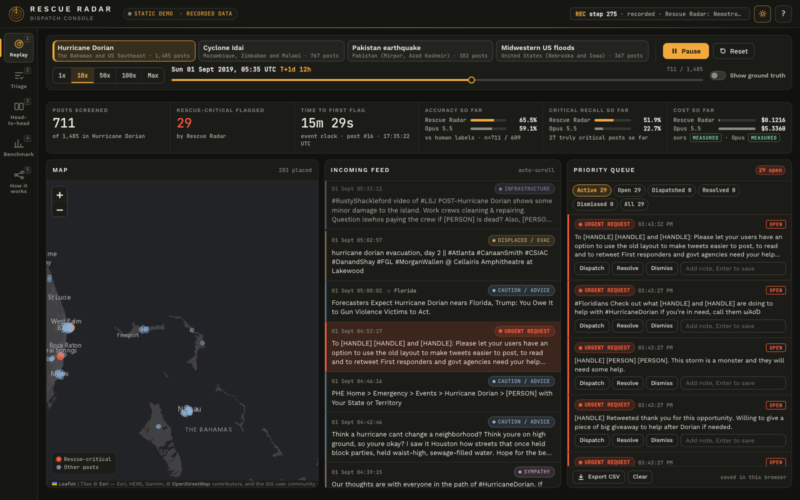
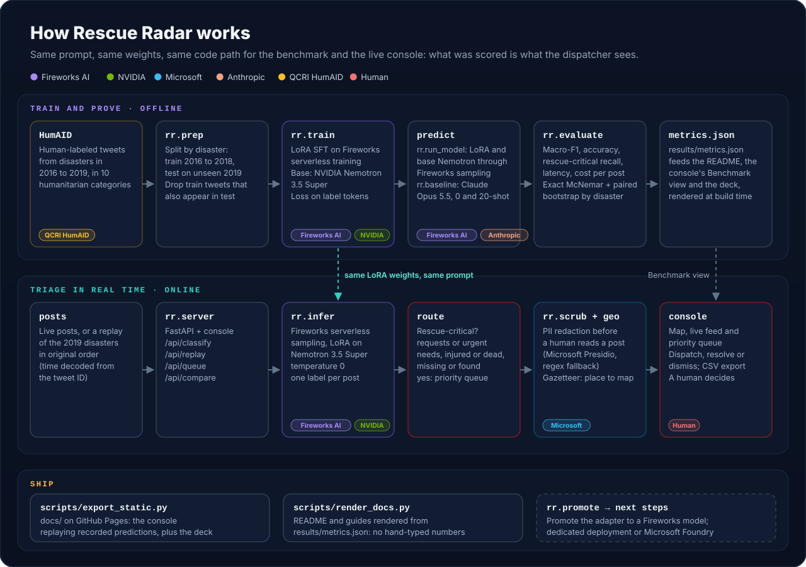
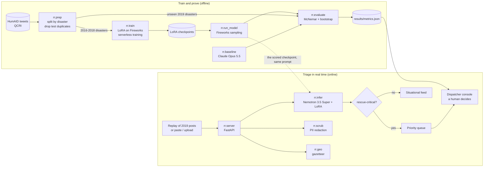

{#- Rendered to README.md by scripts/render_docs.py. Every number below comes from results/metrics.json or data/ at
    render time; anything missing prints as "n/a". Never type a benchmark number into this file. -#}










{#- <picture> sources use absolute raw URLs (GitHub resolves those reliably); the  fallback stays relative. -#}

{#- bump v when the art changes so browsers and GitHub's image proxy fetch fresh copies -#}

<div align="center">

<picture>
  <source media="(prefers-color-scheme: dark)" srcset="{{ raw }}assets/hero.svg{{ v }}">
  <source media="(prefers-color-scheme: light)" srcset="{{ raw }}assets/hero-light.svg{{ v }}">
  
</picture>

### Find the people asking for rescue in the flood of disaster posts, in real time.

[](https://github.com/vnmoorthy/rescue-radar/actions/workflows/ci.yml)
[ }})](LICENSE)
[ }})](https://www.python.org/)
[ }})](https://fireworks.ai/)
[ }})](https://www.nvidia.com/en-us/ai-data-science/foundation-models/nemotron/)

[ }})](https://microsoft.github.io/presidio/)

[ }})](guide/DEPLOYMENT.md)

[", "F59E0B") }})](https://huggingface.co/datasets/QCRI/HumAID-events)
[ }})](#hackathon-disclosure)

[" if headline_ablation else ""), pct(of1), "0E7490") }})](#results)


**[Live demo](https://vnmoorthy.github.io/rescue-radar/)** &nbsp;·&nbsp;
**[Slides](https://vnmoorthy.github.io/rescue-radar/deck/)** &nbsp;·&nbsp;
[Results](#results) &nbsp;·&nbsp; [How it works](#how-it-works) &nbsp;·&nbsp; [Quickstart](#quickstart) &nbsp;·&nbsp;
[Evaluation design](guide/EVALUATION.md)

</div>

---

**Rescue Radar reads every public post during a disaster, sorts it into the {{ num(d.labels_n) }} HumAID humanitarian categories, and pushes the rescue-critical ones (people asking for help, people injured or killed, people missing or trapped) to the top of a dispatcher's queue.** The model is NVIDIA Nemotron 3.5 Super, fine-tuned with LoRA on Fireworks serverless training and served through Fireworks serverless sampling, and it is tested on {{ num(test_events) }} disasters from 2019 that it never saw during training.


> [!IMPORTANT]

> **These are the small-data run's numbers** ({{ num(ours_train.examples) }} training examples, step {{ ours.checkpoint_step }}). The [pre-registration](guide/PREREGISTRATION.md) lists that run as a data-size ablation; the pre-registered main system is not scored yet.
>

> Paired on the **{{ num(cmp.n) }}** held-out posts from {{ num(test_events) }} unseen disasters that both systems answered, Rescue Radar catches **{{ pct(sh_a.critical_recall) }}** of rescue-critical posts against **{{ pct(sh_b.critical_recall) }}** for {{ frontier_name }} (**{{ pts(cmp.delta_critical_recall) }}**, 95% CI {{ ci_pts(bs.critical_recall_delta_ci95) }}{{ ", so the gain is not luck of the draw" if cr_side == "above" else "" }}). Macro-F1 is {{ pct(sh_a.macro_f1) }} against {{ pct(sh_b.macro_f1) }} ({{ pts(cmp.delta_macro_f1) }}, 95% CI {{ ci_pts(bs.macro_f1_delta_ci95) }}): within noise, so we do not claim a macro-F1 win: {{ frontier_name }} is ahead. Rescue-critical precision is lower ({{ pct(ours.critical.precision) }} vs {{ pct(frontier.critical.precision) }}, each on the posts it answered).

>
> It costs **{{ usd(oc) }} per million posts** against {{ usd(fc) }} ({{ ratio(fc, oc) if fc >= oc else ratio(oc, fc) }} {{ "cheaper" if fc >= oc else "more expensive" }} at Fireworks' current rate, which includes a limited-time 50% discount; {{ ratio(fc, ours.cost_per_1m_usd_undiscounted) }} at the undiscounted rate). It is {{ "slower" if ol > fl else "faster" }} per post: median latency {{ ms(ol) }} against {{ ms(fl) }}. Statistics, intervals and caveats are in [Results](#results).


> [!NOTE]
> Benchmark results are **pending**: they appear here automatically when `python -m rr.evaluate` writes `results/metrics.json` and `python scripts/render_docs.py` re-renders this page. So far: the untuned base model, {{ base.name }}, scores {{ pct(base.macro_f1) }} macro-F1 on the {{ num(eval_n) }}-post held-out set.



<!-- growth-sections -->
## See it in 60 seconds

<p align="center">
  
</p>

<p align="center">
  <picture>
    <source media="(prefers-color-scheme: dark)" srcset="{{ raw }}assets/screens/replay-dark.png{{ v }}">
    <source media="(prefers-color-scheme: light)" srcset="{{ raw }}assets/screens/replay-light.png{{ v }}">
    
  </picture>
</p>

1. Open the **[live demo](https://vnmoorthy.github.io/rescue-radar/)**. It runs in your browser: no account, no API key, no backend.
2. In **Live Replay**, pick one of the {{ num(m.eval.test_events) }} held-out 2019 disasters and press <kbd>Space</kbd>. Real posts arrive in their original order; the ones the model marks rescue-critical go to the priority queue, with personal data redacted.
3. Open **Benchmark** to see how those labels score against {{ frontier_name }} on {{ num(m.eval.n) }} posts the model never saw, then flip through the **[slides](https://vnmoorthy.github.io/rescue-radar/deck/)**.

<!-- ===================================================================== (b) Try it locally in 60 seconds -->

## Contents

[Why this matters](#why-this-matters) · [Results](#results) · [How it works](#how-it-works) · [Evaluation design](#evaluation-design-held-out-disasters) · [Quickstart](#quickstart) · [Reproduce the benchmark](#reproduce-the-benchmark) · [Repository layout](#repository-layout) · [Sponsor stack](#sponsor-stack) · [Responsible AI and limitations](#responsible-ai-and-limitations) · [From hackathon to company](#from-hackathon-to-company) · [Roadmap](#roadmap) · [Contributing](#contributing) · [Citation](#citation) · [Team](#team)

## Why this matters

When a hurricane or an earthquake hits, emergency lines saturate, and people turn to public social media to ask for help: an address, a trapped family, a missing child. Those posts are scattered among thousands of prayers, news links, donation drives and jokes. Responders have had to read them by hand.

The signal is rare. In the held-out evaluation set, only **{{ pct(d.eval_critical_share) }}** of posts ({{ num(d.eval_critical_n) }} of {{ num(d.eval_n) }}) are rescue-critical. A dispatcher cannot read the other {{ pct(1 - d.eval_critical_share if d.eval_critical_share is number else none) }} fast enough. Rescue Radar reads all of them and puts the few that matter first, with personal data redacted, a location when the post names a known place, and a human making every decision.

Why a fine-tuned open model instead of a frontier API? What [Results](#results) measures against {{ frontier_name }}: significantly higher rescue-critical recall ({{ pts(cmp.delta_critical_recall) }}, at lower precision) rescue-critical recall {{ pts(cmp.delta_critical_recall) }} (95% CI {{ ci_pts(bs.critical_recall_delta_ci95) }}), macro-F1 and accuracy statistically level, macro-F1 {{ pts(cmp.delta_macro_f1) }} (95% CI {{ ci_pts(bs.macro_f1_delta_ci95) }}), and about {{ ratio(fc, oc) }} lower serving cost ({{ ratio(fc, ours.cost_per_1m_usd_undiscounted) }} at the undiscounted rate). It is slower per post on shared serverless capacity ({{ ms(ol) }} median against {{ ms(fl) }}). The base model is open, so the small LoRA adapter could be exported for an agency to host itself instead of sending every post to a third-party API; that export is not built yet.

## Who is this for

| Who | What they get |
| --- | --- |
| **Emergency operations centers** | Replay a past disaster from your own area in the console (no integration needed), then run Rescue Radar in shadow mode beside your current process during an exercise. You get a priority queue of rescue-critical posts with personal data redacted, a map pin when a post names a known place, and a CSV export of the queue with each dispatcher's decision and notes. |
| **911 and emergency communications centers** | When phone lines saturate, people post publicly instead. Rescue Radar reads all of those posts and puts the {{ pct(d.eval_critical_share) }} that are rescue-critical (in our test set) first, and `/api/classify` lets dispatch software call the same model. It is decision support: a person decides every item. Common Alerting Protocol export is planned, not built. |
| **Relief NGOs** | A situational-awareness feed sorted into the {{ num(d.labels_n) }} HumAID categories (urgent needs, displaced people, infrastructure damage, donations and more), so a response team can see where needs cluster. The code is MIT; the HumAID-trained model inherits CC BY-NC-SA 4.0, so check that license against your use. |
| **Researchers in crisis informatics** | A held-out-disaster benchmark with a [pre-registration](guide/PREREGISTRATION.md), every system's per-post predictions in `data/preds/`, paired McNemar tests and stratified bootstrap intervals, per-disaster and per-category scores, and a script that re-renders every number in the docs. Add your model's predictions and compare on the same {{ num(m.eval.n) }} posts. |

<!-- ===================================================================== (d) Rescue Radar vs a frontier API -->

### Rescue Radar vs a frontier API

Paired on the {{ num(cmp.n) }} held-out posts that both Rescue Radar and {{ frontier_name }} answered. Better value in bold.

| | Rescue Radar | {{ frontier_name }} |
| --- | --- | --- |
| Quality: macro-F1 over {{ num(d.labels_n) }} categories | **{{ pct(cmp.a_on_shared.macro_f1) }}** | {{ pct(cmp.b_on_shared.macro_f1) }} |
| Rescue-critical recall (a missed request is the costly error) | **{{ pct(cmp.a_on_shared.critical_recall) }}** | {{ pct(cmp.b_on_shared.critical_recall) }} |
| Rescue-critical precision (lower means more false alarms) | {{ pct(ours.critical.precision) }} | **{{ pct(frontier.critical.precision) }}** |
| Cost per 1M posts (measured tokens x published price) | **{{ usd(ours.cost_per_1m_usd) }}** ({{ usd(ours.cost_per_1m_usd_undiscounted) }} without Fireworks' limited-time 50% discount) | {{ usd(frontier.cost_per_1m_usd) }} |
| Can run privately | Partly: the base model is open-weight, so an agency could host it; exporting our adapter is not built yet | No: every post goes to a third-party API |
| Latency per post, p50 / p95, as measured in the benchmark run | {{ ms(ours.latency_ms.p50) }} / {{ ms(ours.latency_ms.p95) }} | **{{ ms(frontier.latency_ms.p50) }} / {{ ms(frontier.latency_ms.p95) }}** |

<sub>Differences with 95% paired-bootstrap intervals: macro-F1 {{ pts(cmp.delta_macro_f1) }} ({{ ci_pts(cmp.bootstrap.macro_f1_delta_ci95) }}), rescue-critical recall {{ pts(cmp.delta_critical_recall) }} ({{ ci_pts(cmp.bootstrap.critical_recall_delta_ci95) }}). Cost: {{ ratio(frontier.cost_per_1m_usd, ours.cost_per_1m_usd) }} cheaper at today's Fireworks rate, {{ ratio(frontier.cost_per_1m_usd, ours.cost_per_1m_usd_undiscounted) }} at the undiscounted rate. The cheapest frontier setup we measured, {{ systems.gpt_zero.name }}, costs {{ usd(systems.gpt_zero.cost_per_1m_usd) }} per 1M posts ({{ ratio(systems.gpt_zero.cost_per_1m_usd, ours.cost_per_1m_usd) }} ours), and Rescue Radar is {{ pts(cmp_by_b.gpt_zero.delta_macro_f1) }} ahead of it on macro-F1 ({{ ci_pts(cmp_by_b.gpt_zero.bootstrap.macro_f1_delta_ci95) }}). Latency: Rescue Radar is slower; it ran with 32 parallel requests on shared Fireworks serverless capacity and Claude with 24 through the Anthropic API, so both numbers include load. A dedicated deployment is on the roadmap and not measured.</sub>

<!-- ===================================================================== (e) FAQ -->

## Results

Evaluated on **{{ num(eval_n) }}** posts sampled from {{ num(test_events) }} disasters of 2019, none of which were in our fine-tuning data ([evaluation design](#evaluation-design-held-out-disasters)). Every system gets the same instructions and the same {{ num(d.labels_n) }} category definitions; the 20-shot baselines also get 20 examples. **Not every system answered every post:** the Anthropic account hit its spending cap mid-run, so {{ r.name }} was scored on the {{ num(r.s.n) }} posts it answered ({{ pct(r.s.coverage, 0) }}){{ "," if not loop.last else "." }} Each row's score is on its own posts; the comparisons below are paired on the posts both systems answered.


| System | Posts scored | Macro-F1 | Accuracy | Rescue-critical recall | p50 latency | Cost per 1M posts |
| --- | --- | --- | --- | --- | --- | --- |

| {{ "**" ~ ("Rescue Radar (small-data run)" if headline_ablation else r.name) ~ "**" if r.ours else r.name }} | {{ num(r.s.n) }} | {{ "**" ~ pct(r.s.macro_f1) ~ "**" if r.ours else pct(r.s.macro_f1) }}<br><sub>{{ ci(r.s.ci95.macro_f1) }}</sub> | {{ pct(r.s.accuracy) }}<br><sub>{{ ci(r.s.ci95.accuracy) }}</sub> | {{ pct(r.s.critical.recall) }}<br><sub>{{ ci(r.s.ci95.critical_recall) }}</sub> | {{ ms(r.s.latency_ms.p50) }} | {{ usd(r.s.cost_per_1m_usd) }} |


<sub>Small numbers are 95% bootstrap intervals ({{ num(m.eval.bootstrap_resamples) }} paired resamples of tweets, stratified by disaster). Rescue-critical recall: the share of posts whose true label is one of `{{ k }}`{{ ", " if not loop.last }} that the system also labels as one of those three. Latency is wall-clock time per post as measured during the benchmark run (Rescue Radar and base Nemotron through Fireworks serverless sampling with 32 parallel requests on shared capacity, Claude through the Anthropic API with 24), so it reflects load as well as the model. Cost is measured tokens times published per-token prices:

<br>{{ r.name }}: {{ r.s.cost_note }}.

</sub>

### Is the difference real?


Both systems answered the same {{ num(cmp.n) }} of the {{ num(eval_n) }} posts, so we compare them post by post on those: Rescue Radar {{ pct(sh_a.macro_f1) }} macro-F1 and {{ pct(sh_a.critical_recall) }} rescue-critical recall, {{ frontier_name }} {{ pct(sh_b.macro_f1) }} and {{ pct(sh_b.critical_recall) }}.

- **Paired exact test (McNemar).** Rescue Radar was right where {{ frontier_name }} was wrong on **{{ num(cmp.mcnemar.a_only) }}** posts, and the reverse happened on **{{ num(cmp.mcnemar.b_only) }}** posts. If both systems were equally accurate, a split at least this uneven would happen by chance with {{ pval(cmp.mcnemar.p) }} (log10 p = {{ num(cmp.mcnemar.log10_p) }}).
- **Paired bootstrap, stratified by disaster.** Resampling tweets within each disaster {{ num(cmp.bootstrap.n) }} times, the 95% interval for Rescue Radar minus {{ frontier_name }} is {{ ci_pts(cmp.bootstrap.macro_f1_delta_ci95) }} for macro-F1, {{ ci_pts(cmp.bootstrap.delta_ci95) }} for accuracy and {{ ci_pts(cmp.bootstrap.critical_recall_delta_ci95) }} for rescue-critical recall. Rescue Radar has the higher macro-F1 in {{ num(cmp.bootstrap.a_wins) }} of {{ num(cmp.bootstrap.n) }} resamples.


- **In plain words:** the macro-F1 advantage is not luck of the draw. The whole 95% interval is above zero.

- **In plain words:** {{ frontier_name }} is ahead on macro-F1, and the whole 95% interval of the difference is below zero.

- **In plain words:** the macro-F1 difference is within noise. The 95% interval includes zero, so we do not claim either system is better on that metric.


Statistics are **pending** until `results/metrics.json` contains the comparison between Rescue Radar and the frontier baseline.



<details>
<summary><b>Every pairwise comparison</b></summary>

| Rescue Radar vs | Macro-F1 difference (95% CI) | Accuracy difference (95% CI) | Rescue-critical recall difference (95% CI) | Ours right, theirs wrong / reverse | McNemar |
| --- | --- | --- | --- | --- | --- |

| {{ (systems.get(c.b) or {}).get('name') or c.b }} | {{ pts(c.delta_macro_f1) }} ({{ ci_pts(c.bootstrap.macro_f1_delta_ci95) }}) | {{ pts(c.delta) }} ({{ ci_pts(c.bootstrap.delta_ci95) }}) | {{ pts(c.delta_critical_recall) }} ({{ ci_pts(c.bootstrap.critical_recall_delta_ci95) }}) | {{ num(c.mcnemar.a_only) }} / {{ num(c.mcnemar.b_only) }} | {{ pval(c.mcnemar.p) }} |


</details>


<details>
<summary><b>Per disaster</b>: does it hold up on each unseen event?</summary>

| Disaster (2019) | Posts (rescue-critical) | Rescue Radar macro-F1 | {{ frontier_name }} macro-F1 (n) | Rescue Radar critical recall | {{ frontier_name }} critical recall (critical n) |
| --- | --- | --- | --- | --- | --- |

| {{ event_name(e) }} | {{ num(n) }} ({{ num(ours.per_event[e].critical_support) }}) | {{ pct(ours.per_event[e].macro_f1) }} | {{ pct(frontier.per_event[e].macro_f1) }} (n = {{ num(frontier.per_event[e].n) }}) | {{ pct(ours.per_event[e].critical_recall) }} | {{ pct(frontier.per_event[e].critical_recall) }} ({{ num(frontier.per_event[e].critical_support) }}) |


{{ frontier_name }} columns are scored on the posts it answered (n per row). Critical recall on a disaster with only a handful of rescue-critical posts rests on those few posts; read it as anecdotal, not as a result.

</details>

<details>
<summary><b>Rescue-critical categories</b>: precision, recall and F1 per class</summary>

| Category | Posts in eval set | Rescue Radar P / R / F1 | {{ frontier_name }} P / R / F1 (support on its answered posts) |
| --- | --- | --- | --- |

| {{ label_name(k) }} | {{ num(d.eval_labels[k]) }} | {{ pct(ours.per_class[k].precision) }} / {{ pct(ours.per_class[k].recall) }} / {{ pct(ours.per_class[k].f1) }} | {{ pct(frontier.per_class[k].precision) }} / {{ pct(frontier.per_class[k].recall) }} / {{ pct(frontier.per_class[k].f1) }} ({{ num(frontier.per_class[k].support) }}) |


Small classes have wide intervals: read per-class numbers for categories with few posts as indicative only.

</details>


<sub>Results generated {{ m.generated_at }} by `python -m rr.evaluate`. Full numbers, including confusion matrices: [`results/metrics.json`](results/metrics.json).</sub>


## How it works

1. **Ingest.** Posts arrive one by one. The demo replays the real 2019 disaster tweets in their original order (a tweet ID is a Twitter snowflake, so its post time is `(id >> 22) + 1288834974657` ms), or classifies text you paste or upload. Live stream ingestion is not built yet.
2. **Classify.** One instruction prompt with the {{ num(d.labels_n) }} category definitions, one label out. The LoRA-tuned Nemotron runs on Fireworks serverless sampling at temperature 0; its reasoning block is closed in the prompt so it answers with the label alone.
3. **Prioritize.** Rescue-critical labels (`requests_or_urgent_needs`, `injured_or_dead_people`, `missing_or_found_people`) go to the priority queue. Everything else stays in the situational-awareness feed.
4. **Protect.** Before a person reads a post, `rr/scrub.py` replaces phone numbers, emails, handles, URLs and street addresses with placeholders, and people's names too when Microsoft Presidio is installed (a regex-only engine runs otherwise). This is best effort, and it applies to what the dispatcher sees: the raw post is what goes to the model providers.
5. **Locate.** `rr/geo.py` maps place names in the post to coordinates with a gazetteer of the affected areas. It never guesses a location for a post that names no known place.
6. **Decide.** A dispatcher works the queue: dispatch, resolve or dismiss, with notes, and exports it as CSV. The model ranks; a human decides.

The live console and the benchmark share the same code path, `rr.infer.SamplerClassifier`, with the same prompt from `rr/labels.py`. By default the server serves exactly the checkpoint the benchmark scored for the headline system (recorded in `data/preds/<system>.meta.json`), and the console's header badge says "scored". `RR_LIVE_MODEL=latest` serves the newest training checkpoint instead, and the badge then says it is not scored.

<p align="center">
  <picture>
    <source media="(prefers-color-scheme: dark)" srcset="{{ raw }}assets/architecture.svg{{ v }}">
    <source media="(prefers-color-scheme: light)" srcset="{{ raw }}assets/architecture-light.svg{{ v }}">
    
  </picture>
</p>



More detail: [guide/ARCHITECTURE.md](guide/ARCHITECTURE.md) and the HTTP contract in [guide/API.md](guide/API.md).

## Evaluation design: held-out disasters

A model that has seen a disaster's tweets during training can look much better than it will be on the next disaster. So the split is by **event**, not by tweet:

| | Disasters | Years | Posts |
| --- | --- | --- | --- |
| Train | {{ num(train_events) }} HumAID events | 2016 to 2018 | {{ num(d.train_sft_n) }} in the training file; the scored step-{{ ours_train.step }} checkpoint (of {{ num(ours_train.steps) }} steps) saw {{ num(ours_train.seen) }} of them |
| Test | {{ num(test_events) }} unseen events: {{ event_name(e) }}{{ ", " if not loop.last }} | 2019 | {{ num(d.test_full_n) }} in total; a seeded, event-stratified sample of {{ num(eval_n) }} is the shared eval set |

- **No leakage by copy.** Training tweets whose normalized text also appears in the test events (retweets, copies) are removed: {{ num(d.dedup_removed) }} of {{ num(d.raw_train_n) }} training-event tweets.
- **Prompt parity.** Every system gets the same system prompt and category definitions (`rr/labels.py`). The 20-shot frontier baseline adds two fixed training examples per category.
- **Baselines.** Claude Opus 5.5 (zero-shot and 20-shot) as the strongest frontier reference, and the same Nemotron base model without fine-tuning, served through the same Fireworks path, so the gain from LoRA is isolated. GPT-6.1 Terra (zero-shot and 20-shot, through the OpenAI API) was added after pre-registration.
- **Statistics.** Exact McNemar test on per-post correctness, and a paired bootstrap resampled within each disaster for every interval.
- **Measured, not estimated.** Latency is measured per call; cost is measured token counts times published prices. The choice of the headline system and metrics was fixed before any fine-tuned model was scored on the test set ([`{{ m.eval.preregistration }}`]({{ m.eval.preregistration }})). **Deviation:** the pre-registered main system (the larger run's checkpoint frozen at 14:55) has not been scored yet, so the headline numbers on this page come from the small-data run that the pre-registration lists as an ablation.

The full method is in [guide/EVALUATION.md](guide/EVALUATION.md).

## Try it locally in 60 seconds

```bash
git clone https://github.com/vnmoorthy/rescue-radar.git && cd rescue-radar
python3 -m venv .venv && source .venv/bin/activate
pip install -r requirements.txt
python -m rr.server
```

Open **http://localhost:8787**.

- **No API keys needed for replay mode.** Live Replay streams the predictions committed in `data/preds/`, so the console works on a fresh clone with no `.env`.
- **Live classification needs `FIREWORKS_API_KEY`.** Classifying text you paste or upload calls the fine-tuned model on Fireworks serverless sampling. Put the key in a git-ignored `.env` file in the repo root (see [Quickstart](#quickstart)); the Head-to-Head view also needs `ANTHROPIC_API_KEY` (or `OPENAI_API_KEY` as the fallback).
- Python 3.12. The 60 seconds assume the dependencies are installed: the first `pip install` takes longer (Presidio, spaCy and the tokenizer libraries).

<!-- ===================================================================== (c) Who is this for -->

## Quickstart

Requirements: Python 3.12, a [Fireworks AI](https://fireworks.ai/) API key (training and serving), an [Anthropic](https://console.anthropic.com/) API key (frontier baseline and the Head-to-Head view), optionally an [OpenAI](https://platform.openai.com/) API key (the GPT-6.1 Terra baseline, and the Head-to-Head fallback when the Anthropic account is out of quota) and a [Hugging Face](https://huggingface.co/settings/tokens) token (the Nemotron tokenizer).

```bash
git clone https://github.com/vnmoorthy/rescue-radar.git
cd rescue-radar
python3 -m venv .venv && source .venv/bin/activate
pip install -r requirements.txt
```

Create a `.env` file in the repo root (it is git-ignored; never commit it):

```bash
FIREWORKS_API_KEY=...
ANTHROPIC_API_KEY=...
OPENAI_API_KEY=...      # optional: GPT-6.1 Terra baseline and Head-to-Head fallback
HF_TOKEN=...
```

Then build the data, train, evaluate and open the console:

```bash
python -m rr.prep        # download HumAID, build the held-out-disaster split
python -m rr.train       # LoRA fine-tune on Fireworks serverless training
python -m rr.evaluate    # score every system, write results/metrics.json
python -m rr.server      # dispatch console and API
```

Open **http://localhost:8787**. No keys at hand? The [live demo](https://vnmoorthy.github.io/rescue-radar/) replays the recorded predictions with no backend at all.

## Reproduce the benchmark

```bash
python -m rr.prep                                   # data/eval.jsonl, data/test_full.jsonl, data/train_sft.jsonl
RR_TAG=_full RR_PER_CLASS=1500 python -m rr.train   # headline run: every example in data/train_sft.jsonl
python -m rr.train                                  # small-data ablation run (default 400 per class)
python -m rr.run_model rescue_radar                 # fine-tuned model: the pre-registered checkpoint frozen at 14:55 PT (data/active_model.json)
python -m rr.run_model rescue_radar_quick           # ablation
python -m rr.run_model base_zero                    # Nemotron 3.5 Super without fine-tuning
python -m rr.baseline opus_zero                     # Claude Opus 5.5, zero-shot
python -m rr.baseline opus_few                      # Claude Opus 5.5, 20-shot
python -m rr.baseline gpt_zero                      # GPT-6.1 Terra, zero-shot (added after pre-registration)
python -m rr.baseline gpt_few                       # GPT-6.1 Terra, 20-shot (added after pre-registration)
python -m rr.evaluate                               # results/metrics.json
python scripts/render_docs.py                       # re-render README.md and the guides with the new numbers
```

Every prediction script is resumable: rows already in `data/preds/<system>.jsonl` are skipped. Training writes a sampler checkpoint every 25 steps, so the newest one can be evaluated even if a run is cut short. The scored headline checkpoint is step {{ ours_train.step }} of the {{ num(ours_train.steps) }}-step run, frozen at 14:55 PT per the pre-registration; training continued afterwards and later checkpoints are not scored.

## Repository layout

```text
rescue-radar/
├── rr/                      Python package
│   ├── labels.py            the 10 HumAID categories, RESCUE_CRITICAL, the single prompt
│   ├── prep.py              held-out-disaster split and de-duplication
│   ├── train.py             LoRA fine-tune on Fireworks serverless training
│   ├── infer.py             the live model: Fireworks serverless sampling
│   ├── run_model.py         scores the open models on the eval set
│   ├── baseline.py          scores Claude Opus 5.5 and GPT-6.1 Terra (zero-shot, 20-shot)
│   ├── frontier.py          live Claude call for the Head-to-Head view
│   ├── evaluate.py          metrics, McNemar, stratified bootstrap -> results/metrics.json
│   ├── promote.py           promote a checkpoint to a permanent Fireworks model
│   ├── server.py            FastAPI app: /api/* and the console
│   ├── scrub.py             PII redaction before a human reads a post
│   ├── geo.py               gazetteer: place names -> coordinates
│   └── store.py             dispatcher queue (SQLite in state/)
├── web/                     dispatch console, no build step
├── docs/                    GitHub Pages: static console + slide deck
├── scripts/                 render_docs.py, export_static.py, make_dev_fixtures.py, check_secrets.py
├── data/                    eval set, predictions, training logs (generated)
├── results/metrics.json     benchmark results
├── guide/                   API contract, architecture, evaluation, deployment, demo runbook
├── assets/                  hero and architecture art
└── tests/                   pytest suite (runs without API keys)
```

## Sponsor stack

| Sponsor | What we use | Where in the code |
| --- | --- | --- |
| **Fireworks AI** | Serverless LoRA training (`create_lora_training_client`, cross-entropy on the label tokens, Adam steps, `save_weights_for_sampler` checkpoints) and serverless sampling of the trained adapter (`create_sampling_client`). The benchmark and the live console use the same sampling path. | `rr/train.py`, `rr/infer.py`, `rr/run_model.py`, `rr/promote.py` |
| **NVIDIA** | Nemotron 3.5 Super (`nvidia-nemotron-3p5-super-vl-120b-a12b-bf16` on Fireworks) is the base model we fine-tune; its tokenizer comes from Hugging Face. | `rr/train.py`, `rr/infer.py` |
| **Microsoft** | [Microsoft Presidio](https://microsoft.github.io/presidio/) (presidio-analyzer with spaCy, presidio-anonymizer) redacts personal data before a dispatcher reads a post, merged with regexes for handles, URLs and addresses; when Presidio is not installed, the regex engine runs alone.PII redaction before human review (`rr/scrub.py`). Deployment to Microsoft Foundry is a documented next step, not yet implemented: see [guide/DEPLOYMENT.md](guide/DEPLOYMENT.md). | `rr/scrub.py` |

Also used: **Anthropic** Claude Opus 5.5 as the frontier baseline (`rr/baseline.py`, `rr/frontier.py`), **OpenAI** GPT-6.1 Terra as a second frontier baseline added after pre-registration (`rr/baseline.py`), and **QCRI**'s HumAID dataset.

## Tech stack: what each piece made possible

| Technology | What it enabled |
| --- | --- |
| **Fireworks AI** serverless LoRA training and sampling | Fine-tuning a large open model in an afternoon with no GPUs to provision, a sampler checkpoint every 25 steps (which made the pre-registered 14:55 freeze possible), and serving the exact scored checkpoint to the live console through the same code path as the benchmark. |
| **NVIDIA Nemotron 3.5 Super** (open weights) | The base model we fine-tune. Open weights are what make private hosting by an agency possible later; the LoRA lifts it by {{ pts(cmp_by_b.base_zero.delta_macro_f1) }} macro-F1 and {{ pts(cmp_by_b.base_zero.delta_critical_recall) }} rescue-critical recall. |
| **HumAID** (QCRI) | Human-labeled tweets from {{ num(d.all_events_n) }} disasters, enough to train on {{ num(m.eval.train_events) }} and test on {{ num(m.eval.test_events) }} unseen ones. |
| **Microsoft Presidio** + spaCy | PII redaction before a dispatcher reads a post, merged with regexes for handles, URLs and addresses. |
| **FastAPI** + uvicorn, plain JavaScript | The dispatch console and HTTP API with no front-end build step; a static export of the same console runs on GitHub Pages with no backend. |
| **Claude Opus 5.5** and **GPT-6.1 Terra** | Frontier baselines, scored with the same prompt and category definitions. |
| NumPy, Jinja2, python-pptx | Exact McNemar tests and stratified bootstrap; docs rendered from `results/metrics.json` so no number is typed by hand; the PPTX deck. |

## Responsible AI and limitations

- **A human decides.** Rescue Radar ranks posts; it never dispatches anyone. Every queue item needs a dispatcher's action, and the model can be wrong, especially on a kind of disaster or a way of writing it has not seen.
- **Old data, one platform.** HumAID is English-language Twitter data from 2016 to 2019. Language, platforms and the way people ask for help have changed since; performance on today's platforms is untested.
- **The most important classes are the smallest.** In the eval set, `requests_or_urgent_needs` has {{ num(d.eval_labels.requests_or_urgent_needs) }} posts and `missing_or_found_people` has {{ num(d.eval_labels.missing_or_found_people) }}. Per-class numbers for them have wide intervals, and a high overall score does not guarantee every request is caught.
- **Uneven coverage.** {{ event_name(d.eval_top_event) }} alone is {{ pct(d.eval_top_event_share) }} of the eval set; results are weighted toward that disaster (per-disaster numbers are reported separately).
- **Most posts have no location.** The gazetteer only resolves places it knows by name; posts without a named place have no coordinates and must be located by a person.
- **Redaction is best effort.** PII redaction reduces exposure; it does not guarantee that no personal data reaches a reader (the small spaCy model misses some names). It applies to what the dispatcher sees: raw posts are sent to the model providers (Fireworks, and Anthropic or OpenAI for the frontier comparison).
- **Not every baseline answered every post.** {{ r.name }} answered {{ num(r.s.n) }} posts ({{ pct(r.s.coverage, 0) }}) before the Anthropic spending cap. Comparisons are paired on the posts both systems answered.
- **Unseen by our fine-tune, not necessarily by every model.** The 2019 test disasters are absent from our fine-tuning data, but they are public tweets (and HumAID has been public since 2021), so we cannot rule out that any model saw them in pretraining.
- **Non-commercial data.** HumAID is licensed CC BY-NC-SA 4.0. The code in this repo is MIT, but models trained on HumAID and derived data inherit the non-commercial, share-alike terms.

## From hackathon to company

What exists today is a working dispatch console, an HTTP API and a held-out benchmark. This section is the plan for turning them into a company. It is a plan, not a track record: there are no customers, partners or prices yet.

**Who pays.** Organizations that must find people in trouble during a disaster, and today read public posts by hand or not at all:

- city, county and state emergency management agencies and their emergency operations centers;
- emergency communications and dispatch centers;
- humanitarian organizations that run response operations;
- vendors of dispatch and emergency-management software, who would embed the API in products agencies already use.

**Product surfaces.**

| Surface | What it is | Status |
| --- | --- | --- |
| Dispatch console | Map, priority queue, situational feed, dispatch / resolve / dismiss with notes, CSV export | Built (this repo) |
| Triage API | `/api/classify` and the queue endpoints, for dispatch and emergency-management software | Built; a product needs authentication, rate limits and an uptime commitment |
| Private deployment | The open-weight base model plus our adapter, run in the customer's own cloud or data center | Planned: adapter export is not built yet |
| Standard alert export | Queue items as Common Alerting Protocol (CAP) messages for dispatch systems | Planned |

**Pricing model.** No prices are set. The model we would test: an annual subscription per agency for the console (seats plus a baseline volume of posts), usage-based pricing per post for software vendors on the API, surge capacity during declared disasters, and a separate license for private deployments. Pilots come first.

**Why margins can be strong.** The main variable cost is the model call, and it is measured, not estimated: {{ usd(oc) }} per million posts on Fireworks serverless ({{ usd(ours.cost_per_1m_usd_undiscounted) }} at the undiscounted rate), against {{ usd(fc) }} for the frontier baseline ({{ frontier_name }}) and {{ usd(cheap.s.cost_per_1m_usd) }} for the cheapest frontier configuration we measured ({{ cheap.name }}), which also scored lower macro-F1 in the paired comparison (Rescue Radar {{ pts(cc.delta_macro_f1) }}, 95% CI {{ ci_pts(cc.bootstrap.macro_f1_delta_ci95) }}). Per-token pricing keeps the cost per post flat as volume grows, and because the base model is open-weight, serving is not tied to one frontier provider's price list: the same adapter could run on a dedicated Fireworks deployment or, once export is built, on a customer's own hardware. A subscription priced on the value of finding requests, on top of that cost, leaves room for healthy gross margins.

**A data moat from dispatcher feedback.** Every dispatcher action is a label: a dispatched, resolved or dismissed item says whether the model ranked that post well. With each customer's consent, those labels become training data for the next adapter (see [Roadmap](#roadmap)), so the model keeps learning the platforms, languages and kinds of disaster that customers actually see. A new adapter would ship only if it beats the current one on held-out disasters, with the same paired statistics as this benchmark. This matters for licensing too: the current adapter is trained on HumAID, which is non-commercial (CC BY-NC-SA 4.0), so a commercial product needs commercially licensed training data, from a license with the dataset's authors or from customers' own labels.

**Open weights, run privately.** Nemotron 3.5 Super is an open-weight model. An agency that cannot send posts to a third-party API could run the base model and our adapter inside its own environment, and personal data is already redacted before a dispatcher reads a post.

**Go to market.**

1. **Pilots with emergency operations centers.** Replay a past disaster from the agency's own area through the console (the replay mode exists today), then run Rescue Radar in shadow mode next to the current process during an exercise or a live activation, and measure what it catches and what it misses.
2. **Partnerships with dispatch-software vendors.** Agencies get Rescue Radar inside tools they already bought, through procurement they have already done; the vendor gets a measured triage model without building one.
3. **Expand by region and language.** Each new deployment adds feedback labels; multilingual evaluation is on the roadmap.

**Risks, and how the product handles them.**

| Risk | How Rescue Radar handles it |
| --- | --- |
| Liability for a missed or wrong call | It is decision support: the model ranks, and a dispatcher decides every queue item. It never drops a post: anything not marked rescue-critical stays in the situational feed for a person to read. Recall and precision on unseen disasters are published with intervals, including the weak side: rescue-critical precision is {{ pct(ours.critical.precision) }} against {{ pct(frontier.critical.precision) }} for {{ frontier_name }}, so dispatchers see more false alarms in exchange for fewer missed requests. see [Results](#results). |
| Long public-sector procurement cycles | Start with pilots that replay past events (no integration needed), and sell through software vendors that agencies already buy from. |
| Platform data access | Social platforms restrict and charge for API access, and their terms change. The model classifies any text, by paste, upload or API, so customers connect the sources they are licensed to use; voice intake is on the roadmap. Live stream ingestion is not built yet. |
| Drift to new platforms, languages and disasters | Retrain from dispatcher feedback, and gate every new adapter on held-out disasters before it ships. |
| Privacy | PII is redacted before human review (best effort, see [limitations](#responsible-ai-and-limitations)), and private deployment keeps posts inside the agency. |

## FAQ

<details>
<summary><b>The data is from 2016 to 2019. Does this work on today's posts?</b></summary>

We do not know yet, and we say so. HumAID is English-language Twitter data; the test disasters are from 2019 and none of them were in training. Platforms and the way people ask for help have changed since, so performance on today's platforms is untested. Results also vary by disaster: rescue-critical recall is {{ pct(ours.per_event.cyclone_idai_2019.critical_recall) }} on Cyclone Idai but {{ pct(ours.per_event.hurricane_dorian_2019.critical_recall) }} on Hurricane Dorian. Newer and multilingual evaluation is on the roadmap.
</details>

<details>
<summary><b>Who is liable if it misses someone?</b></summary>

Rescue Radar is decision support, not a dispatcher. The model ranks posts; a person decides every queue item, and nothing is dropped: posts not marked rescue-critical stay in the situational feed for a person to read. We publish the weak side next to the strong side, with intervals, so an agency can judge the risk before a pilot.
</details>

<details>
<summary><b>How many false alarms does it raise?</b></summary>

More than the frontier model. Rescue-critical precision is {{ pct(ours.critical.precision) }} against {{ pct(frontier.critical.precision) }} for {{ frontier_name }}, so about {{ pct(1 - ours.critical.precision if ours.critical.precision is number else none, 0) }} of the posts it flags are not rescue-critical. That is the trade we chose: the pre-registered primary metric is recall on rescue-critical posts ({{ pct(ours.critical.recall) }}), because a missed rescue request costs more than a dispatcher dismissing a false alarm. The weakest category is `requests_or_urgent_needs` (precision {{ pct(ours.per_class.requests_or_urgent_needs.precision) }}, recall {{ pct(ours.per_class.requests_or_urgent_needs.recall) }}; only {{ num(ours.per_class.requests_or_urgent_needs.support) }} test posts carry that label), where most false alarms are donation and volunteering posts.
</details>

<details>
<summary><b>How fast is it?</b></summary>

Slower than a frontier API today: {{ ms(ours.latency_ms.p50) }} median and {{ ms(ours.latency_ms.p95) }} p95 per post during the benchmark, against {{ ms(frontier.latency_ms.p50) }} median for {{ frontier_name }}. Rescue Radar ran on shared Fireworks serverless capacity with 32 parallel requests, so these numbers include load. A dedicated Fireworks deployment for steady latency is the first roadmap item; we have not measured it.
</details>

<details>
<summary><b>What happens to personal data?</b></summary>

Before a dispatcher reads a post, `rr/scrub.py` replaces phone numbers, emails, handles, URLs and street addresses with placeholders, and names too when Microsoft Presidio is installed. Redaction is best effort and applies to what the dispatcher sees: the raw post is what the model provider (Fireworks) classifies. Because the base model is open-weight, posts could stay inside an agency's own environment once adapter export is built; it is not built yet.
</details>

<details>
<summary><b>What is the license?</b></summary>

The code is [MIT](LICENSE). The data is not: HumAID is CC BY-NC-SA 4.0, so the fine-tuned model and files derived from HumAID inherit its non-commercial, share-alike terms ([DATA_LICENSE.md](DATA_LICENSE.md)). A commercial product would need commercially licensed training data.
</details>

<details>
<summary><b>Can I reproduce the benchmark?</b></summary>

Yes. The per-post predictions of every system are committed in `data/preds/`, so `python -m rr.evaluate` recomputes every number in `results/metrics.json` (McNemar tests, {{ num(m.eval.bootstrap_resamples) }}-sample stratified bootstrap) without any API key. To regenerate the predictions themselves, follow [Reproduce the benchmark](#reproduce-the-benchmark); that needs Fireworks and Anthropic keys and costs money. The test set, systems, metrics and checkpoint rule were fixed in the [pre-registration](guide/PREREGISTRATION.md) before any fine-tuned model was scored, and its one correction is logged in it.
</details>

<details>
<summary><b>Why not just prompt a frontier model?</b></summary>

We tried, and measured it. On the {{ num(cmp.n) }} posts both answered, {{ frontier_name }} caught {{ pct(cmp.b_on_shared.critical_recall) }} of rescue-critical posts against {{ pct(cmp.a_on_shared.critical_recall) }} for Rescue Radar ({{ pts(cmp.delta_critical_recall) }}, 95% CI {{ ci_pts(cmp.bootstrap.critical_recall_delta_ci95) }}), at {{ ratio(frontier.cost_per_1m_usd, ours.cost_per_1m_usd) }} the cost per post. Fine-tuning on {{ num(m.eval.train_events) }} earlier disasters teaches the model where the HumAID category boundaries are. The frontier model still has real advantages: higher rescue-critical precision, lower latency, and no training step. The same LoRA also lifts the untuned base model by {{ pts(cmp_by_b.base_zero.delta_macro_f1) }} macro-F1.
</details>

<!-- ===================================================================== (f) Star and share, How to cite -->

## Roadmap

- [ ] Dedicated Fireworks deployment of the promoted model for steady latency at disaster-time volume
- [ ] Microsoft Foundry deployment path for agencies that run on Azure
- [ ] Learn from dispatcher actions: dispatched and dismissed items become new training labels
- [ ] Cluster near-duplicate requests so one address is not dispatched five times
- [ ] Location extraction beyond the gazetteer (named-entity recognition plus a geocoder) with uncertainty shown on the map
- [ ] Multilingual evaluation and newer events from other crisis datasets
- [ ] Calibrated confidence and an "unsure, send to a human" path, then confidence-aware escalation of uncertain posts to a frontier model (the policy the downshifting paper by a team member recommends testing)
- [ ] Voice intake for people who cannot reach 911: a talking [masky.ai](https://masky.ai/) avatar line that answers the call, PAVO-style routing across the speech-to-LLM pipeline, and Rescue Radar triage of the transcript
- [ ] Export queue items as Common Alerting Protocol (CAP) messages for dispatch systems

## Star and share

If Rescue Radar is useful to you, **star the repo** so people in emergency management and crisis informatics can find it, and share the **[live demo](https://vnmoorthy.github.io/rescue-radar/)**: it runs in any browser with no install. Found a post it gets wrong? [Open an issue](https://github.com/vnmoorthy/rescue-radar/issues/new/choose) with the text (remove personal data first). Contributions are welcome: see [CONTRIBUTING.md](CONTRIBUTING.md).

**How to cite.** Use GitHub's **Cite this repository** button (it reads [CITATION.cff](CITATION.cff)) or the BibTeX under [Citation](#citation), and please cite the HumAID dataset (Alam et al., ICWSM 2021) too.

<!-- ===================================================================== (g) Built in one afternoon -->

## Contributing

Contributions are welcome: bug reports, evaluation ideas, new disasters, better redaction. Read [CONTRIBUTING.md](CONTRIBUTING.md) and our [Code of Conduct](CODE_OF_CONDUCT.md). Please report security issues privately as described in [SECURITY.md](SECURITY.md).

## Citation

If you use Rescue Radar, please cite this repository and the HumAID dataset ([CITATION.cff](CITATION.cff)):

```bibtex
@software{rescue_radar_2026,
  title  = {Rescue Radar: real-time triage of disaster posts with a LoRA-tuned open model},
  author = {vnmoorthy and Caldwell, Seth},
  year   = {2026},
  url    = {https://github.com/vnmoorthy/rescue-radar},
  note   = {Built at the Fireworks: Deploy hackathon, San Francisco}
}

@inproceedings{alam2021humaid,
  title     = {HumAID: Human-Annotated Disaster Incidents Data from Twitter with Deep Learning Benchmarks},
  author    = {Alam, Firoj and Qazi, Umair and Imran, Muhammad and Ofli, Ferda},
  booktitle = {Proceedings of the International AAAI Conference on Web and Social Media (ICWSM)},
  year      = {2021}
}
```

## Acknowledgments

- [QCRI](https://www.hbku.edu.qa/en/qcri) for HumAID, the human-annotated disaster tweets this work is built on.
- [Fireworks AI](https://fireworks.ai/) for serverless LoRA training and sampling, and for hosting Fireworks: Deploy.
- [NVIDIA](https://www.nvidia.com/) for the Nemotron 3.5 Super open model.
- [Microsoft](https://microsoft.github.io/presidio/) for Presidio, used for PII redaction.
- [Anthropic](https://www.anthropic.com/) for Claude Opus 5.5, our frontier baseline.
- [OpenAI](https://openai.com/) for GPT-6.1 Terra, a second frontier baseline (added after pre-registration) and the Head-to-Head fallback.
- The responders and volunteers who read disaster feeds by hand, whose work inspired this project.

## Team

| | |
| --- | --- |
| **NarasingaMoorthy VeiluKanthaPerumal** | [@vnmoorthy](https://github.com/vnmoorthy) · [Google Scholar](https://scholar.google.com/citations?user=s7C14hwAAAAJ&hl=en) |
| **Seth Caldwell** | [masky.ai](https://masky.ai/) |

### Prior research by a team member

Rescue Radar is a downshifting decision: replacing a frontier model with a smaller open one. Before this hackathon, a member
of this team published on exactly that question in *How Much Quality Survives LLM Downshifting?* (TMLR, 08/2026,
[OpenReview](https://openreview.net/forum?id=6ccINAFoJi)), which shows that LLM-judged "quality preserved" figures swing
from 61% to 97% depending on the judge, and on routing inference across speech pipelines in *PAVO* (TMLR, 08/2026,
[OpenReview](https://openreview.net/forum?id=zrneoIxlFx)). Our evaluation follows the first paper's advice: human labels
instead of an LLM judge, intervals on every number, two prompting protocols per frontier model, real disaster posts.
PAVO is the blueprint for the voice-intake item on our roadmap. The Rescue Radar code, data split, fine-tune and benchmark
were built during the event. Full citations: [guide/REFERENCES.md](guide/REFERENCES.md).

## Built in one afternoon

Everything here was built on **November 2, 2026** at Fireworks: Deploy. Times are Pacific, taken from the files named in the right column.

| Time (PT) | Step | Evidence |
| --- | --- | --- |
| by 13:29 | **Data split.** HumAID split by disaster: {{ num(ours_train.examples) }} training examples from {{ num(m.eval.train_events) }} disasters (2016 to 2018), and {{ num(m.eval.n) }} test posts from {{ num(m.eval.test_events) }} unseen disasters of 2019 | file time of `data/eval.jsonl` |
| {{ d.runs.quick.started[:5] }} | **Training starts.** The small-data run (3,939 examples) at {{ d.runs.quick.started[:5] }} and the main run ({{ num(ours_train.examples) }} examples, {{ num(ours_train.steps) }} planned steps) at {{ ours_run.started[:5] }}, both LoRA on Fireworks serverless training | `data/train_log.jsonl`, `data/train_log_full.jsonl` |
| 13:47 to 13:58 | **Baselines.** Untuned Nemotron 3.5 Super, Claude Opus 5.5 zero-shot and 20-shot (stopped early by the API spending cap), GPT-6.1 Terra zero-shot and 20-shot (added after pre-registration) | file times in `data/preds/` |
| 13:49 | **Pre-registration** of the test set, systems, metrics, statistics and the checkpoint rule, before any fine-tuned model was scored | [`guide/PREREGISTRATION.md`](guide/PREREGISTRATION.md) |
| {{ d.runs.quick.finished[:5] }} | Small-data run finishes ({{ num(d.runs.quick.steps) }} steps); it becomes the data-size ablation | `data/train_log.jsonl` |
| 14:40 | Correction logged in the pre-registration (the small run's size, 3,839 to 3,939); nothing else changed | [`guide/PREREGISTRATION.md`](guide/PREREGISTRATION.md) |
| {{ d.active_model.frozen_at[:5] }} | **Freeze.** By the pre-registered rule, the main run's newest checkpoint saved by 14:55, step {{ d.active_model.step }} (saved {{ d.active_model.at }}), is frozen as the main system at {{ d.active_model.frozen_at }}.{{ " The run was still training; later checkpoints are not scored, because test scores never pick a checkpoint." if d.active_model.run_finished == false else "" }} | [`data/active_model.json`](data/active_model.json) |
| about 15:02 | Frozen checkpoint scored on all {{ num(m.eval.n) }} test posts | file time of `data/preds/rescue_radar.jsonl` |
| 15:05 | **Product.** First public commit: dispatch console, HTTP API, static demo on GitHub Pages, slide deck and docs | `git log` |
| {{ m.generated_at[11:16] }} | `results/metrics.json` generated with paired statistics for every system | `results/metrics.json` |
| 15:26 onward | **QA.** Light and dark themes across console, site, deck and README art (15:26), cache-busted assets (15:33), then a QA pass over the console, site, deck and docs | `git log` |

<!-- ===================================================================== (h) Tech stack, optional -->

## Hackathon disclosure

Rescue Radar was built during **Fireworks: Deploy** in San Francisco on **November 2, 2026**. AI coding assistants were used while writing the code and documentation. The dataset is HumAID by QCRI; we did not collect or label any data. Frontier-baseline predictions come from Claude Opus 5.5 through the Anthropic API and GPT-6.1 Terra through the OpenAI API. The live Head-to-Head calls Claude Opus 5.5 and switches to GPT-6.1 Terra when the Anthropic account is out of quota; each result names the model that answered.

## License

Code: [MIT](LICENSE). Data: HumAID is CC BY-NC-SA 4.0 (non-commercial, share-alike); it is downloaded from its source by `rr.prep`, and files derived from it in `data/` keep that license.
