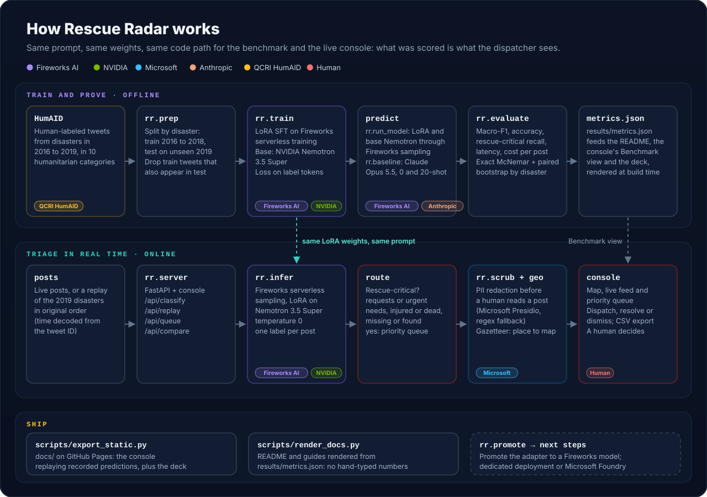

# Architecture

Rescue Radar has two halves that share one model path: an **offline** pipeline that trains the model and proves
how good it is on disasters it never saw, and an **online** service that triages posts for a dispatcher. A third,
small part **ships** the results: rendered docs and a static demo on GitHub Pages.



The one rule that ties it together: the live console and the benchmark share the same code path,
`rr.infer.SamplerClassifier`, with the same prompt from `rr/labels.py`, and by default the server serves exactly the
checkpoint the benchmark scored for the headline system (from `data/preds/<system>.meta.json`; the console badge says
"scored"). `RR_LIVE_MODEL=<system>` pins another scored system, and `RR_LIVE_MODEL=latest` defers to
`rr.infer.get_classifier()` (`data/active_model.json`, else the newest training checkpoint, marked "not scored").

## Offline: train and prove

| Step | Module | What it does |
| --- | --- | --- |
| Data | `rr/prep.py` | Downloads HumAID (QCRI) per event from Hugging Face into `data/raw/`. Splits **by disaster**: every 2016 to 2018 event is training data, the four 2019 events are test data. Removes training tweets whose normalized text also appears in the test events. Writes `data/test_full.jsonl`, a seeded event-stratified sample `data/eval.jsonl` (the shared eval set), and `data/train_sft.jsonl` (capped per class, chat format). |
| Prompt | `rr/labels.py` | The 10 categories with one-line definitions, `RESCUE_CRITICAL`, `build_messages()` and `parse_label()`. Every system uses this prompt. |
| Train | `rr/train.py` | LoRA (rank 16) on **Fireworks serverless training** with the Firetitan SDK: `create_lora_training_client` on NVIDIA Nemotron 3.5 Super, cross-entropy on the label tokens only (prompt tokens have weight 0), Adam steps, and `save_weights_for_sampler` every 25 steps. Logs to `data/train_log<tag>.jsonl`, checkpoints to `data/checkpoints<tag>.json`. |
| Predict | `rr/run_model.py`, `rr/baseline.py` | Runs every system over `data/eval.jsonl` and writes one row per tweet to `data/preds/<system>.jsonl` (label, prediction, latency, tokens). Open models go through Fireworks serverless sampling; Claude Opus 5.5 goes through the Anthropic API, zero-shot and 20-shot. Resumable. |
| Score | `rr/evaluate.py` | Accuracy, macro-F1, rescue-critical precision/recall/F1, per event, per class, confusion matrices, latency percentiles and cost per post; exact McNemar tests and a paired bootstrap stratified by disaster. Writes `results/metrics.json`. See [EVALUATION.md](EVALUATION.md). |
| Promote | `rr/promote.py` | Promotes a sampler checkpoint to a permanent Fireworks model that outlives the training session (for a dedicated deployment; see [DEPLOYMENT.md](DEPLOYMENT.md)). |

## Online: triage in real time

```text
post ──> rr.server (FastAPI) ──> rr.infer ──> label ──┬─ rescue-critical ──> priority queue ──> dispatcher
                │                (Fireworks           │                       (rr.store, SQLite)
                │                 serverless          └─ other ─────────────> situational feed
                ├──> rr.scrub   PII redaction before a human reads the post
                └──> rr.geo     place name -> lat/lng for the map (never guesses)
```

| Component | Module | Notes |
| --- | --- | --- |
| HTTP API | `rr/server.py` | FastAPI app; serves `/api/*` and the console at `/`. The contract is [API.md](API.md). The model loads lazily on the first classify request; when it is unavailable the API answers HTTP 503 with a readable `detail` instead of crashing. Port 8787 by default (`RR_PORT`). |
| Model | `rr/infer.py` | `SamplerClassifier` wraps a Fireworks serverless sampling client for the active checkpoint (`data/active_model.json` if present, otherwise the newest checkpoint). Temperature 0, at most 16 new tokens; the reasoning block is closed in the prompt so the model answers with the label only. `RR_MODE=base` serves the untuned base model through the same path. |
| Frontier comparison | `rr/frontier.py` | Live frontier call with the same prompt and the same 20 examples as the 20-shot benchmark, for the Head-to-Head view (`/api/compare`): Claude Opus 5.5, switching to GPT-6.1 Terra (OpenAI API) when the Anthropic account is out of quota (`RR_FRONTIER=claude|gpt|auto`). Each result names the model that answered. |
| PII redaction | `rr/scrub.py` | Replaces phone numbers, emails, handles, URLs and street addresses with placeholders, plus people's names when Microsoft Presidio (presidio-analyzer with spaCy `en_core_web_sm`, presidio-anonymizer) is installed. Falls back to the regex engine when Presidio is missing or `RR_SCRUBBER=regex`. Returns the spans so the console can highlight them. |
| Location | `rr/geo.py` | Gazetteer of places in the affected areas. Word-boundary, case-insensitive matching, CamelCase hashtags split first, most specific place wins. Returns `None` when no known place is named. |
| Queue | `rr/store.py` | The dispatcher's queue in SQLite under `state/` (git-ignored). Idempotent on `post_id`; statuses `open`, `dispatched`, `resolved`, `dismissed`; CSV export. |
| Console | `web/` | No build step. Views: Live Replay, Triage Desk, Head-to-Head, Benchmark, How it works (keys 1 to 5). Rescue-critical categories render in the red and orange family in both themes. |

### Replay

The demo replays the real held-out tweets of a 2019 disaster in their original order. A tweet ID is a Twitter
snowflake, so its post time in milliseconds is `(int(id) >> 22) + 1288834974657`. Replay posts carry the recorded
predictions from `data/preds/rescue_radar.jsonl` once that run is complete (its `.meta.json` exists or it covers every
eval post), otherwise from `data/preds/rescue_radar_quick.jsonl`, plus `data/preds/opus_few.jsonl`, so the replay works
without calling a model; live classification is one click away. Map pins are placed from the PII-redacted text.

## Ship

| Script | Output |
| --- | --- |
| `scripts/render_docs.py` | Renders every `*.template.md` / `*.template.html` with numbers from `results/metrics.json` and `data/` (README, [EVALUATION.md](EVALUATION.md), [DEMO_RUNBOOK.md](DEMO_RUNBOOK.md)). Missing values render as `n/a`. |
| `scripts/export_static.py` | `docs/`: the console in static mode (recorded predictions, no backend) plus the slide deck, served by GitHub Pages. |
| `scripts/make_dev_fixtures.py` | `web/data/`: local fixtures for developing the console's static adapter. |
| `scripts/check_secrets.py` | Fails if a file git would commit contains an API key. |

## Secrets

Keys live only in a git-ignored `.env` file and are read only through `rr.env.load_env()`:
`FIREWORKS_API_KEY` (training and sampling), `ANTHROPIC_API_KEY` (frontier baseline), `OPENAI_API_KEY` (optional:
GPT-6.1 Terra baseline and Head-to-Head fallback), `HF_TOKEN` (Nemotron
tokenizer), and `FIREWORKS_ACCOUNT_ID` for `rr.finetune` and `rr.promote`.
